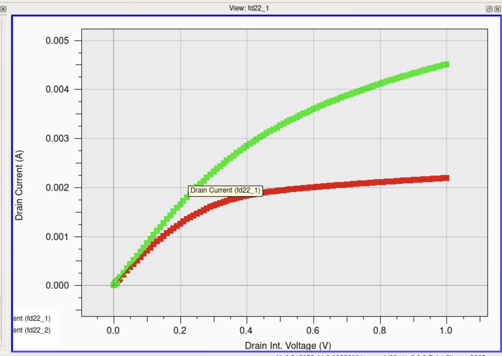
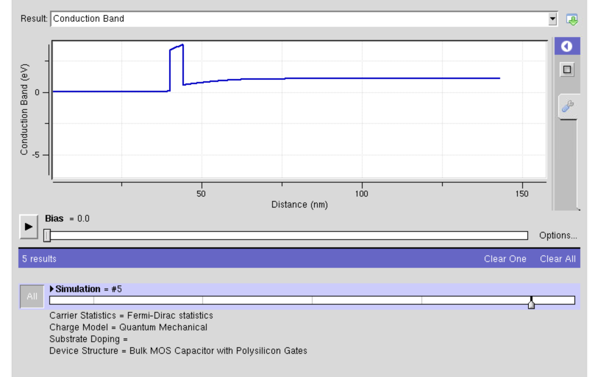
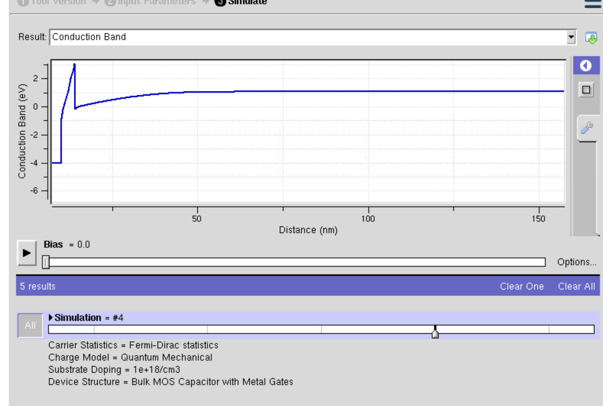
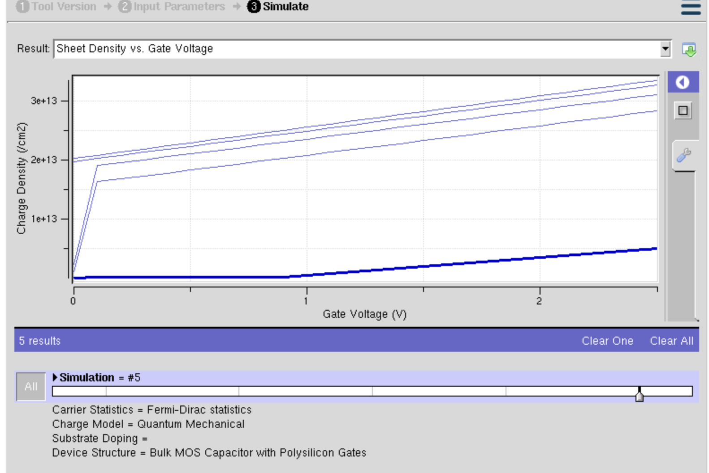
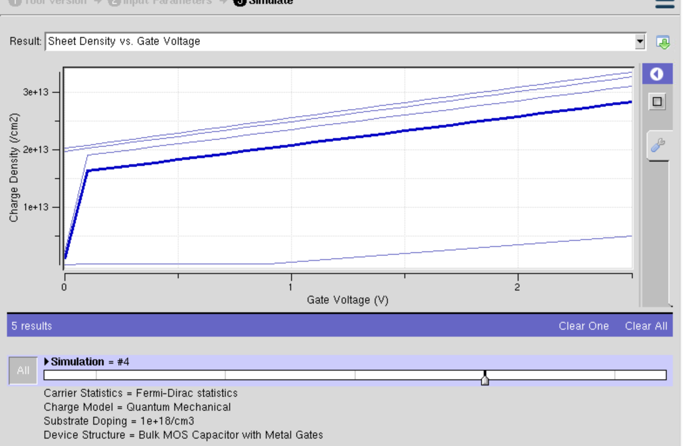

# Semiconductor Device Modeling

> Semiconductor device modeling from band structure to TCAD, in Python, MATLAB, and Silvaco

        




## Overview
Graduate coursework for EEE 533 (Semiconductor Device and Process Simulation, ASU, Fall 2025) spanning hand-coded numerical solvers and commercial TCAD. The work moves from quantum band-structure and carrier-statistics calculations in Python, through custom 1D Poisson and drift-diffusion PN-junction solvers in MATLAB, to Silvaco Victory/ATLAS device simulations of MOSFETs, SOI transistors, MOS capacitors, and MESFETs/HEMTs. It culminates in an IEEE-style paper on gate leakage and high-k dielectric scaling.

**Highlight:** HfO2 cuts gate leakage ~1.8e5x vs SiO2 (85.3 to 4.73e-4 A/cm2) at 1.0 nm EOT

**Highlight:** HfO2 cuts gate leakage ~1.8e5x vs SiO2 (85.3 to 4.73e-4 A/cm2) at 1.0 nm EOT

## Key Achievements
- Implemented an empirical pseudopotential method (EPM) in Python to compute band structures of Si, Ge, GaAs, and Al(x)Ga(1-x)As, recovering indirect gaps at X (Si) and L (Ge) and a direct gap at Gamma (GaAs) close to Cohen-Bergstresser and experimental values (Si 1.1, Ge 0.7, GaAs 1.4 eV)
- Wrote a from-scratch 1D equilibrium Poisson solver and a drift-diffusion PN-diode solver in MATLAB using a Gummel loop, Scharfetter-Gummel discretization, SRH recombination, and a custom tridiagonal LU routine, then validated against the depletion approximation (peak field within 3-5%, depletion width 33-42% wider as expected from gradual charge transitions)
- Built Silvaco TCAD decks characterizing a 180 nm bulk NMOS (extracting Vth, subthreshold slope ~79.3 mV/dec, DIBL ~39.6 mV/V), short- vs long-channel and SOI FD/PD devices, drift-diffusion vs hydrodynamic/energy-balance transport with self-heating, and depletion-mode MESFETs
- Authored an IEEE-format paper showing HfO2 reduces gate leakage ~1.8e5-fold versus SiO2 at 1.0 nm EOT in a 15 nm MOSFET, cutting gate current density from 85.3 to 4.73e-4 A/cm2 using quantum-corrected band-to-band tunneling models
- Modeled carrier statistics in Python, including 3D/2D/1D density of states, Fermi-Dirac vs Maxwell-Boltzmann comparison, and donor freeze-out via a bisection root-finder on the charge-neutrality equation, with auto-generated HTML lab reports

## Approach
Each problem was approached numerically from first principles where feasible, building solvers (EPM Hamiltonian diagonalization, tridiagonal LU, Gummel/Scharfetter-Gummel iteration, bisection) rather than relying on canned routines, then cross-checking against analytical limits such as the depletion approximation and published reference values. Device-scale problems used Silvaco Victory Device/ATLAS with explicit mesh refinement, physical model selection (CVT, SRH, Auger, field mobility, impact ionization, quantum/density-gradient corrections), and automated parameter extraction. Python labs embed results, equations, and plots into self-contained HTML reports.

## Tools & Technologies
- Python
- NumPy
- SciPy
- Matplotlib
- MATLAB
- Silvaco Victory Device
- Silvaco ATLAS
- TCAD input decks

## Gallery





## Repository Structure
```
.gitignore
.nojekyll
LICENSE
README.md
docs/EEE533_Elsaady_Project1.pdf
docs/EEE533_FinalProject.pdf
docs/EEE533_Lab_1_Introductory_Concepts-1.pdf
docs/Elsaady_Lab_2_-_MOSFET_Modeling_with_Silvaco_1_-2.pdf
docs/Lab_3_-_SOI_Device_Modeling_with_Silvaco_2025.docx.pdf
docs/Lab_4_ELsaady_Fall_2025.docx.pdf
docs/Lab_5_MESFETs_and_HEMTs_Elsaady.docx.pdf
docs/Project_2_EEE533_Report_2_.pdf
images/fig1.png
images/fig2.png
images/fig3.png
images/fig4.png
images/fig5.png
images/fig6.png
images/preview.png
index.html
src/EEE533_Elsaady_Project1-1.py
src/EquilibriumSolver_EEE533PART1_1_.m
src/Lab1_Introductory_Concepts_Elsaady_EEE533-1.py
src/eee533lab2.in
src/lab3part1.in
src/lab3part2.in
src/lab3part3.in
src/lab3part4.in
src/nonequilibriumSolver_EEE533PART2_1_.m
```

## Results
Deliverables include working solvers, eight Silvaco TCAD decks, and written reports; quantitative highlights are the HfO2 vs SiO2 leakage reduction (1.8e5x, 85.3 to 4.73e-4 A/cm2) and PN-diode field agreement within 3-5% of the depletion approximation. See docs/EEE533_FinalProject.pdf for the full paper.

## Deliverable
See [`docs/EEE533_FinalProject.pdf`](docs/EEE533_FinalProject.pdf).
